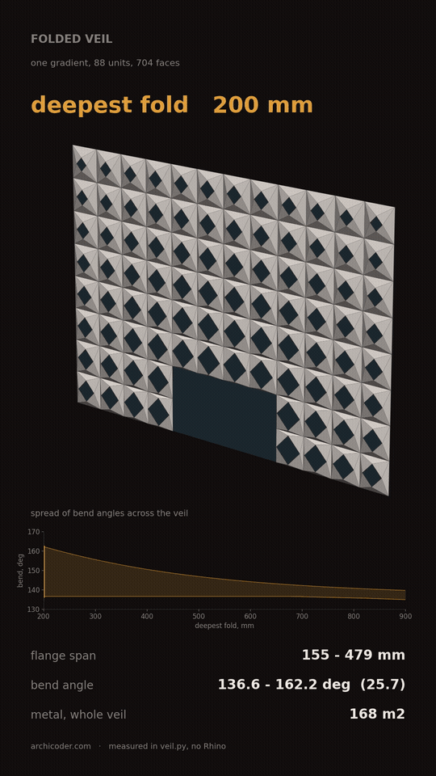
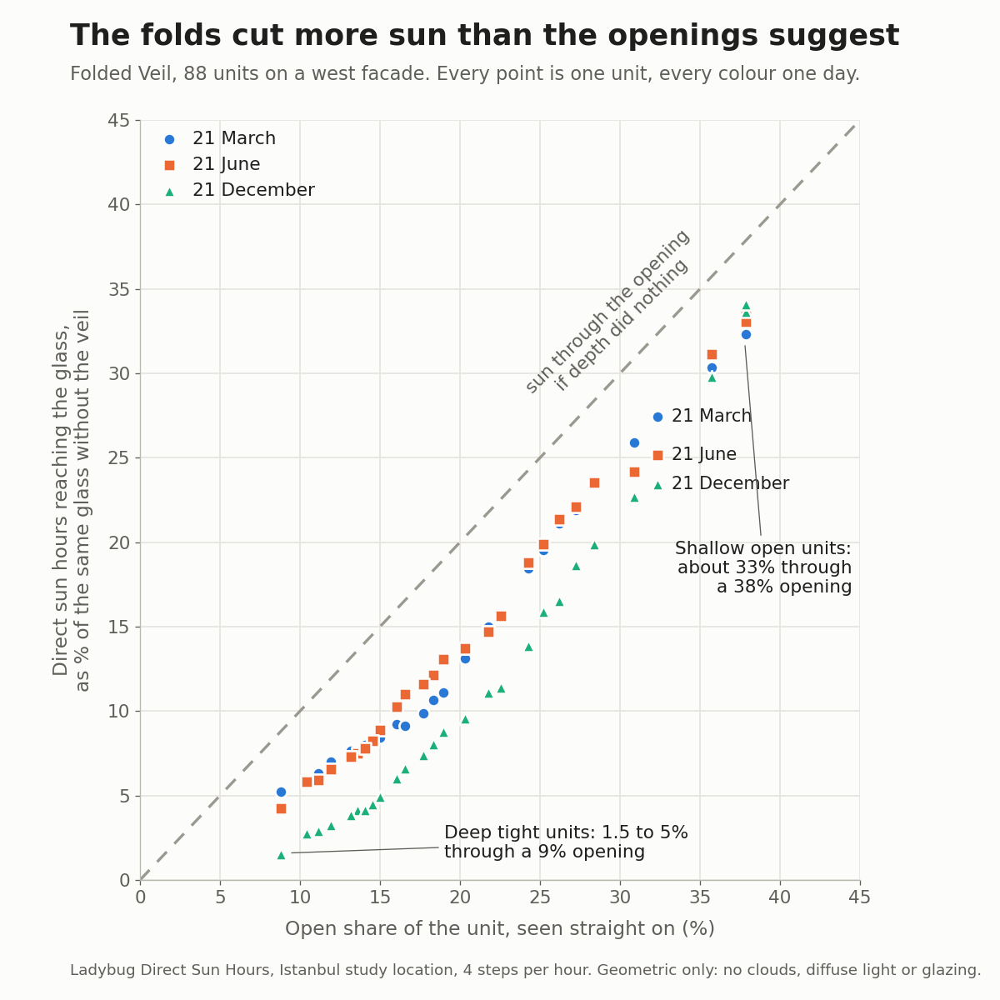

# Folded Veil

A folded aluminium veil over an 18 x 12 m glazed facade, followed from a
parametric shape to sheet pieces, fabrication families, nesting, an IFC model
and a sun-hours study. Everything is measured from the coordinates, in plain
Python, and checked by tests.



Project page: [archicoder.com/projects/folded-veil](https://archicoder.com/projects/folded-veil/)
· Model in Speckle: [public viewer](https://app.speckle.systems/projects/0f83cf24a9/models/5a3b3c7dd5)

## The geometry

6 bays x 4 floors, each 3 x 3 m cell split into four 1.5 x 1.5 m units.
96 positions less 8 at the 6 x 3 m entrance: **88 units, 8 triangles each,
704 triangles, 352 sheet pieces** (four identical two-triangle pieces per unit,
one fold each).

One field value `f` in 0..1 drives each unit:

```
d = 0.12 + (Dmax - 0.12) * f      fold depth, pushed out along -Y   (Dmax = 0.90 m)
r = 0.75 * (0.87 - 0.45 * f)      aperture half-diagonal
```

The field is **radial from the entrance**: the veil is open where people
arrive and closes as it climbs away. That is a design decision, not a solar
optimisation. A bare elevation gives no field to derive one from: annual
irradiation on the unshaded west glass is the same on all 88 units.

## What the measurements say

**The shape was the easy part.** Depth runs 120 to 900 mm (7.5 : 1) and the
folded flange 155 to 1000 mm, but the fold angle stays between 136.6 and
139.7 degrees across the whole gradient. Raising Dmax from 200 to 900 mm
narrows the spread of fold angles from 25.7 to 4.8 degrees. A narrow range
suggests few press-brake setups. It does not prove one: blank size, flange
length and springback also decide the setup.

**Five families cost metal, not sheets.** The free radial gradient has 26
unit families. Grouping them into five, each rounded up to its deepest member,
raises developed metal from 249.4 to 266.4 m2 (+6.8%). Choosing the five
levels with an exact 1D partition instead of uniform fifths cuts the depth
deviation by 31% for the same part count.

**Nesting is where the gradient is paid for.** On 2000 x 4000 mm stock
(10 mm edge trim, 3 mm kerf), placing pieces one by one needs an estimated
91 sheets. Pairing each piece with a copy turned 180 degrees, so the notch of
one takes the point of the next, brings it to 57. Five families need 58.
These are shelf-packing estimates, an upper bound, not an optimal nest.
The 1500 mm frame edge is exactly the width of 1500 x 3000 stock, so with any
trim it does not fit; 2000 x 4000 is what makes the veil cuttable.

**The data survives the IFC round trip.** The IFC4 export carries one
`IfcPlate` per unit with stable IDs and property sets. Reopened locally, all
1,144 scheduled values match the CSV, with zero geometry difference. Two units
were also checked by eye in Speckle; that is a sample check, not a full
comparison of the imported data.

**The folds cut more sun than the openings suggest.** Ladybug direct sun
hours at the glass, west facade, Istanbul as a study location:

| Date | Bare glass | With the veil | Reduction |
|---|---:|---:|---:|
| 21 March | 6.25 h | 1.02 h | 84% |
| 21 June | 7.50 h | 1.23 h | 84% |
| 21 December | 4.50 h | 0.59 h | 87% |

Shallow units admit about 33% of the sun through a 38% opening on all three
dates. Deep units admit 4 to 5% through a 9% opening in March and June, and
1.5% in December, when the low sun strikes the facade at a steep angle.



## Run it

Python 3.10 or later. The geometry, field and nesting scripts use only the
standard library.

```
python src/veil.py          # geometry and the 101-step sweep -> results.json
python src/field.py         # field study -> field_results.json
python src/nest.py          # nesting -> nest_results.json, fabrication_schedule.csv
python tests/test_veil.py   # 32 checks

pip install -r requirements-bim.txt
python src/bim.py           # IFC4 export -> exports/FV-05-free-radial.ifc
python tests/test_bim.py    # 4 IFC round-trip tests
```

## Rhino and Grasshopper

- `rhino/FV-folded-veil-reference.3dm` holds the published veil from the IFC
  read-back, with each unit's properties as user text, plus glass, frames,
  entrance and indicative slab edges. Metres; +X along the facade, -Y outward,
  +Z up. Built by `src/make_project_3dm.py`.
- `grasshopper/FV-folded-veil.gh` regenerates the same veil from native
  components: Dmax slider, entrance point, radial field, eight vertices per
  unit, mesh, and a check group. It matches the reference file with zero
  vertex difference. Built by `grasshopper/build_fv_definition.py`.
- `grasshopper/FV-LB01-direct-sun-hours.gh` is the sun-hours study (Ladybug
  Tools). Built by `grasshopper/build_lb01_definition.py`; set `LB_MONTH` and
  `LB_DAY` for other dates. Inputs in `exports/sun-hours/`.

One setting matters: in `LB Direct Sun Hours`, `geo_block_ = False` also turns
off the check of which way a surface faces, so west glass counts morning sun
from behind (15 h on 21 June instead of 7.5). The study uses `True` with a
10 mm offset, and checks that the bare-glass case is uniform.

## Files

```
src/            geometry, field, nesting, IFC export, figures, animation
tests/          geometry and IFC tests
grasshopper/    definitions and the scripts that build them
rhino/          reference model
exports/        IFC, read-back, validation, sun-hours inputs and results
media/          figures, animation, sun-hours video
docs/           live 3D model (veil-live.html), review notes, LB-01 guide
results.json, field_results.json, nest_results.json, fabrication_schedule.csv
```

## Limits

Open midsurfaces. No metal thickness, bend allowances, joints, fixings,
glazing or supporting structure. Not ready for fabrication. Nesting figures
are estimates. Sun hours are geometric potential only: no clouds, diffuse
light, glazing properties or neighbouring buildings, and Istanbul is a study
location, not a surveyed site.

## License

MIT. See `LICENSE`.
